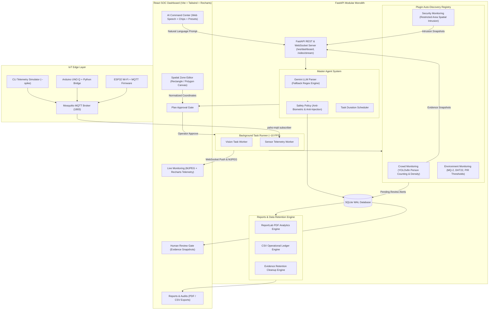

# OmniSense AI — AI+IoT Real-Time Autonomous Monitoring Monolith
### Production Multi-Modal Monitoring Platform

**OmniSense AI** is an intelligent AI+IoT edge-to-cloud monitoring platform. Operators can command multi-modal surveillance and environmental tasks in natural language (English and Hinglish). The backend Master Agent converts prompts into formal structured plans, submits them through a strict **Plan Approval Gate**, launches autonomous background vision and telemetry workers, visualizes annotated video and live sensor telemetry on a React Security Operations Center (SOC) dashboard, and surfaces actionable incident alerts under a **Human-in-the-Loop Incident Verification Gate**.

---

## Key Architectural Principles & Privacy Guarantees

1. **Zero Face Recognition & Zero Identity Tracking**:
   - The vision pipeline enforces privacy at the architectural level.
   - Ultralytics YOLOv8n is locked exclusively to COCO Class 0 (`person`).
   - Raw video frames are ephemeral and processed in-memory without persistent identity embeddings.
   - Prompts requesting facial recognition, biometric indexing, or suspect identification are automatically blocked by the Master Agent Safety Policy.

2. **Operator Approval Gate**:
   - AI never autonomously executes tasks or code.
   - Natural language instructions are translated into strict Pydantic `MonitoringPlan` definitions with explanation cards.
   - All plans default to `pending_approval` until an operator reviews thresholds and clicks **Approve**.

3. **Human-in-the-Loop Incident Review**:
   - Detection events start as `pending_review` and are labeled **"AI-detected, needs human review"**.
   - An incident is only marked `confirmed` after an authorized operator inspects the visual evidence snapshot and telemetry metrics.

4. **Modular Monolith**:
   - Clean, decoupled subsystems: `api/`, `agents/`, `vision/`, `monitoring/` (plugins), `iot/`, `reports/`, `database/`, `firmware/`, `frontend/`.

---

## System Architecture



---

## Directory Layout

```
.
├── backend/
│   ├── main.py                     # FastAPI entrypoint, CORS, static evidence mount, lifespan
│   ├── config.py                   # Pydantic v2 Settings, directories, credentials
│   ├── database/
│   │   ├── connection.py           # SQLAlchemy SQLite engine & sessionmaker
│   │   ├── models.py               # User, AgentPlan, MonitoringTask, Device, Event, AuditLog, ReportRecord, MonitoringProfile
│   │   ├── crud.py                 # Query & transaction helpers
│   │   └── init_db.py              # Schema migration & baseline seed data
│   ├── vision/
│   │   ├── detector.py             # YOLOv8n singleton (person class 0), HUD annotations
│   │   └── camera.py               # Non-blocking threaded OpenCV capture + synthetic fallback
│   ├── monitoring/
│   │   ├── base.py                 # MonitoringPlugin abstract base class & dataclasses
│   │   ├── registry.py             # Dynamic plugin auto-discovery
│   │   ├── runner.py               # TaskRunnerManager & background workers (~10 FPS)
│   │   ├── cleanup.py              # Automatic evidence retention cleanup engine
│   │   ├── crowd/                  # Crowd density classification & overcrowding alerts
│   │   ├── environment/            # Temperature, humidity, gas leak threshold monitor
│   │   └── security/               # Restricted area spatial polygon intrusion monitor
│   ├── reports/
│   │   └── generator.py            # Formal PDF & CSV analytical report generator
│   ├── iot/
│   │   ├── telemetry_schema.py     # Pydantic validation for incoming sensor payloads
│   │   ├── mqtt_client.py          # Threaded paho-mqtt subscriber with auto-reconnect
│   │   ├── telemetry.py            # Device auto-registration & 30s offline watchdog
│   │   ├── simulator.py            # CLI sensor publisher with --spike flag
│   │   └── run_broker.py           # Standalone pure-Python MQTT broker (zero-Docker)
│   ├── agents/
│   │   ├── schemas.py              # Pydantic MonitoringPlan, PlanExplanation
│   │   ├── safety.py               # SafetyPolicy (privacy, prompt-injection, human-review)
│   │   ├── fallback_parser.py      # Regex parser for English & Hinglish (100% benchmark)
│   │   ├── llm_parser.py           # Google Gemini GenAI integration
│   │   ├── tools.py                # Safe registered agent tools
│   │   ├── scheduler.py            # Automatic task duration stop handler
│   │   └── master_agent.py         # End-to-end intent -> plan pipeline
│   └── api/
│       ├── auth.py                 # JWT login, registration, password updates, default credential flag
│       ├── limiter.py              # In-memory sliding-window rate limiter
│       ├── agent.py                # POST /agent/command, /plans/{id}/approve, audit logs
│       ├── tasks.py                # Start/stop background monitoring tasks
│       ├── devices.py              # Device CRUD, health, approval, telemetry history
│       ├── events.py               # Incident alerts query, human review PATCH endpoint
│       ├── reports.py              # POST /reports/generate, GET /reports, download
│       ├── profiles.py             # Reusable monitoring profiles and one-click activation
│       ├── video.py                # Live MJPEG stream endpoint (/video/stream)
│       ├── websocket.py            # Real-time dashboard broadcast (/ws/dashboard)
│       └── overview.py             # Aggregated stats for dashboard cards
├── frontend/
│   ├── src/
│   │   ├── components/layout/      # Navbar, Sidebar, DashboardLayout
│   │   ├── context/                # AuthContext (JWT session), ToastContext
│   │   ├── services/               # api.js (HTTP client), websocket.js (live socket)
│   │   ├── pages/
│   │   │   ├── Login.jsx           # SOC operator login
│   │   │   ├── Overview.jsx        # SOC telemetry & metrics overview
│   │   │   ├── CommandCenter.jsx   # Natural language AI input + Zone Editor + Profiles
│   │   │   ├── LiveMonitoring.jsx  # Live MJPEG stream + Recharts real-time graphs
│   │   │   ├── Devices.jsx         # IoT Device ledger & admin approval
│   │   │   ├── EventsAlerts.jsx    # Evidence inspection & review drawer
│   │   │   ├── Reports.jsx         # Date range filter & PDF/CSV report generation
│   │   │   ├── AuditLogs.jsx       # Immutable prompt & safety decision ledger
│   │   │   └── Settings.jsx        # Runtime threshold settings & privacy pledge
│   │   ├── App.jsx                 # React Router protected routes
│   │   └── main.jsx                # Root entry point
│   ├── package.json
│   ├── vite.config.js
│   ├── tailwind.config.js
│   ├── nginx.conf                  # Production reverse-proxy configuration
│   └── Dockerfile                  # Multi-stage Nginx container build
├── firmware/
│   ├── arduino_uno_q/              # MCU sketch + Linux Python bridge + wiring notes
│   └── esp32/                      # ESP32 Wi-Fi + MQTT Arduino sketch
├── docker-compose.yml              # Complete 3-service compose spec (mosquitto + backend + frontend)
├── mosquitto.conf                  # MQTT authentication and topic config
├── requirements.txt                # Python backend dependencies
├── evaluate.py                     # Performance, accuracy, and safety benchmark suite
├── test_phase*.py                  # Automated integration test suites (Phases 1-6)
└── docs/
    ├── SAFETY_AND_PRIVACY.md       # Ethical & privacy technical guarantee documentation
    └── TESTING.md                  # Comprehensive test coverage & measured results
```

---

## Environment Variables Reference

| Variable | Default Value | Description |
|---|---|---|
| `ENVIRONMENT` | `development` | Deployment environment (`development` or `production`) |
| `SECRET_KEY` | `omnisense-super-secret-jwt-key-change-in-production-2026` | Cryptographic secret for signing JWT tokens |
| `ALGORITHM` | `HS256` | JWT signing algorithm |
| `ACCESS_TOKEN_EXPIRE_MINUTES` | `1440` | JWT token validity lifespan (24 hours) |
| `DATABASE_URL` | `sqlite:///./omnisense.db` | SQLAlchemy database connection URI |
| `MQTT_BROKER_HOST` | `localhost` | MQTT broker hostname |
| `MQTT_BROKER_PORT` | `1883` | MQTT broker TCP port |
| `MQTT_USERNAME` | `omnisense_user` | MQTT subscriber authentication username |
| `MQTT_PASSWORD` | `omnisense_pass` | MQTT subscriber authentication password |
| `DEVICE_OFFLINE_TIMEOUT_SECONDS`| `30` | Heartbeat watchdog timeout before marking device offline |
| `CAMERA_INDEX` | `0` | Default host webcam hardware index |
| `YOLO_MODEL_NAME` | `yolov8n.pt` | Ultralytics YOLO model weight file |
| `EVIDENCE_DIR` | `./evidence` | Directory for persisting snapshot evidence frames |
| `DATA_RETENTION_DAYS` | `30` | Data retention policy: auto-purge evidence older than N days |
| `GEMINI_API_KEY` | `""` | Google Gemini API key (optional; offline fallback operates with 100% accuracy) |

---

## Hardware Wiring Reference

OmniSense AI supports multi-sensor edge nodes reading temperature, relative humidity, combustible gas/smoke, and passive infrared motion.

### 1. Arduino UNO Q Pinout Table

| Sensor | Sensor Pin | Arduino Pin | Operating Voltage | Wiring / Safety Notes |
|---|---|---|---|---|
| **DHT22** | `VCC` | `5V` or `3.3V` | 3.3V – 5.0V | 10k pull-up resistor between `DATA` and `VCC` |
| **DHT22** | `DATA` | `D2` | Digital I/O | Standard digital input |
| **DHT22** | `GND` | `GND` | 0V | Ground reference |
| **MQ-2** | `VCC` | `5V` | 5.0V | Heater requires 5.0V supply (~150mA) |
| **MQ-2** | `AOUT` | `A0` | 0.0V – 5.0V | **CRITICAL (3.3V MCU Protection):** If connecting to a 3.3V ADC, use a voltage divider (10k / 20k resistors) to step down the 0–5V analog signal to 0–3.3V max! |
| **MQ-2** | `GND` | `GND` | 0V | Ground reference |
| **PIR** | `VCC` | `5V` or `3.3V` | 3.3V – 5.0V | Direct supply |
| **PIR** | `OUT` | `D3` | Digital I/O | High (1) indicates motion detected |
| **PIR** | `GND` | `GND` | 0V | Ground reference |

### 2. ESP32 Pinout Table

| Sensor | Sensor Pin | ESP32 GPIO Pin | Operating Voltage | Safety Notes |
|---|---|---|---|---|
| **DHT22** | `DATA` | `GPIO 4` | 3.3V | Powered from 3.3V rail |
| **MQ-2** | `AOUT` | `GPIO 34` (ADC1) | 0.0V – 3.3V | Use voltage divider if MQ-2 module outputs 5.0V analog |
| **PIR** | `OUT` | `GPIO 13` | 3.3V | Direct logic input |

---

## Quickstart Guide

### Option 1: Native Host Launch (Recommended for Laptop Webcams)

#### 1. Start the MQTT Broker
If Docker is not installed on your system, use the built-in standalone Python broker:
```powershell
python backend/iot/run_broker.py
```
*(Or if Docker is installed: `docker compose up -d mosquitto`)*

#### 2. Start the Backend API
In a second terminal:
```powershell
python backend/main.py
```
- API Docs: `http://localhost:8000/docs`
- Health: `http://localhost:8000/api/health`

#### 3. Start the React SOC Dashboard
In a third terminal:
```powershell
cd frontend
npm run dev
```
Open `http://localhost:5173` in your browser.

#### 4. Run the IoT Sensor Simulator
In a fourth terminal:
```powershell
# Standard telemetry stream:
python backend/iot/simulator.py

# Inject hazard spikes (triggers gas & temperature alarms):
python backend/iot/simulator.py --spike
```

---

### Option 2: Full Docker Compose Deployment

```powershell
docker compose up -d
```
- React Frontend (Nginx): `http://localhost`
- FastAPI Backend: `http://localhost:8000`
- Mosquitto MQTT: `localhost:1883`

> **Note on Webcams in Docker:** Desktop Docker containers on Windows and macOS do not natively pass physical USB webcam hardware. When running in Docker, OmniSense AI seamlessly activates its high-fidelity synthetic camera generator with live HUD overlays for continuous end-to-end testing.

---

## Interactive Manual Demo Walkthrough

### 1. Sign In
1. Navigate to `http://localhost:5173/login`.
2. Click **Admin (Full Access)** (or enter `admin` / `admin123`).
3. Click **Sign In to SOC Terminal**.

### 2. Quick-Activate a Monitoring Profile
1. In **AI Command Center**, notice the **Quick Presets / Monitoring Profiles** bar at the top:
   - 🛡️ **Crowd Safety Mode**
   - 🔥 **Fire & Hazard Detection Mode**
   - 🚨 **Restricted Area Mode**
2. Click **Restricted Area Mode**.
3. The **Plan Approval Gate** immediately stages the plan with intent `start_monitoring` and module `security_monitoring`.
4. Observe the **Spatial Zone Boundary Editor** canvas:
   - Drag the X-Left, X-Right, Y-Top, and Y-Bottom sliders to adjust the restricted polygon area on the screen.
5. Click **Approve & Start Monitoring**.
6. The background vision worker begins processing frames at ~10 FPS.

### 3. Live Monitoring Feed
1. Click **Live Monitoring** in the sidebar.
2. Observe your webcam feed showing:
   - Semi-transparent restricted zone overlay (green when clear).
   - Person bounding boxes with confidence scores.
   - Live Temperature, Humidity, and Gas concentration line graphs updating over WebSocket `/ws/dashboard`.

### 4. Trigger an Intrusion Alert & Operator Review
1. Move your hand or step inside the defined restricted zone coordinates.
2. The zone border flashes red with status `BREACH DETECTED!`.
3. A critical toast alert notifies the operator.
4. Go to **Events & Alerts** in the sidebar.
5. Notice the alert tagged with **"AI-detected, needs human review"**.
6. Click **Inspect** to view the snapshot evidence image, model confidence score, and detection coordinates.
7. Select **Confirm**, enter operator notes (*"Visual intrusion confirmed in restricted zone"*), and click **Save Review Decision**.

### 5. Generate Operational Reports
1. Click **Reports & Audits** in the sidebar.
2. Select **PDF Document** or **CSV Ledger** (optionally filter by date range).
3. Click **Generate & Compile**.
4. Click **Download** on the generated report to inspect the formal executive summary, event breakdown tables, and device fleet inventory.

### 6. Test Privacy Guardrails
1. Return to **AI Command Center**.
2. Type a prohibited request:
   `"Track and identify faces of suspects in camera 1"`
3. The system halts the prompt and displays a red **Command Blocked by OmniSense Safety Guardrails** notice.
4. Click **Audit Logs** (Admin only) to verify that the attempt was logged to the immutable security ledger.

---

## Known Limitations & Boundary Rules

1. **No Facial Recognition or Individual Tracking**:
   - OmniSense AI strictly models anonymous aggregate counts and spatial occupancy. It does not identify people or store visual identity descriptors.
2. **Approval Gate Rule**:
   - The master agent never runs shell commands or executes code dynamically. Every action requires human sign-off.
3. **Lighting & Optical Occlusions**:
   - Extreme optical occlusions or total darkness may degrade person detection accuracy. Edge installations should ensure adequate scene illumination.
4. **Physical Webcams in Virtualized Environments**:
   - Host execution (`python backend/main.py`) provides direct low-latency access to physical camera devices. Virtualized containers fallback to synthetic test patterns if no hardware camera is mounted.

---

## License
MIT License. Built for OmniSense AI Milestone 1.
