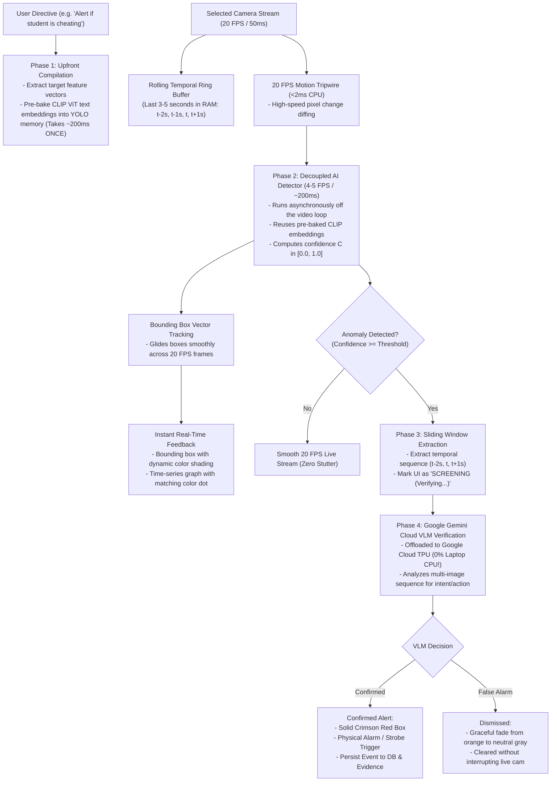

# OmniSense AI — Architecture Optimization & System Blueprint

> **Living Technical Blueprint & Progress Tracker**  
> *Last Updated: November 2026*  
> *Rule: No hardcoded assumptions, no hardcoded scenario scripts, fully grounded in production reality.*

---

## 1. Architectural Vision & Core Principles

OmniSense AI is evolving into a high-throughput, low-latency, universal monitoring platform. The architecture adheres to five foundational pillars:

1. **Zero Hardcoded Scenario Rules**: No rigid scenario folders (e.g., no hardcoded `cheating/` or `fall/` scripts). All monitoring goals are parsed dynamically from natural language directives.
2. **Pluggable & Modular Hardware Abstraction**: Operators can dynamically select and switch both vision sources (laptop webcam, Arduino UNO Q edge camera, mobile phone IP stream) and sensor streams (Arduino USB/WiFi sensors vs. laptop internal thermals/telemetry) without restarting the system.
3. **Decoupled Perception & Reasoning**: Fast, high-FPS temporal screening occurs locally on the edge/client, while deep cognitive verification (VLM) runs asynchronously off the main video path.
4. **Zero-Lag Live Video Path**: The optical live-stream path must remain non-blocking (aiming for consistent 25–30 FPS) regardless of AI reasoning, database transactions, or network I/O.
5. **Continuous Bottleneck Tracking**: Every identified performance bottleneck is analyzed in depth, resolved conceptually, verified, and implemented without introducing fragile workarounds.

---

## 2. Dynamic Component & Sensor Selection Architecture

> **Status: IMPLEMENTED & VERIFIED** (`backend/iot/hardware_discovery.py`, `GET /api/devices/hardware/discover`, `POST /api/devices/hardware/select`, `HardwareSelectorPanel.jsx`)

The platform enforces a **Strict Hardware Reality Rule**: *Only expose and poll hardware sensors that are physically present and verified accessible. Never assume sensors exist or invent mock data.*

```
                      ┌───────────────────────────────────────┐
                      │ Dynamic Hardware Selector (UI Config) │
                      └──────────────────┬────────────────────┘
                                         │
                 ┌───────────────────────┴───────────────────────┐
                 ▼                                               ▼
     [Vision Source Binding]                         [Sensor Source Binding]
  ├── Laptop Integrated Webcam (0)                ├── Physical Arduino UNO Q (Serial COM5)
  ├── External USB Webcam (1, 2)                  │   └── DHT22 Temp, MQ-2 Gas, PIR Motion
  ├── Arduino UNO Q Edge Stream (IP:8080)         │       (Only shown when COM detected!)
  └── Phone IP Webcam URL                         └── Laptop Host Telemetry (Native psutil)
                                                      ├── CPU Utilization % (cpu_percent)
                                                      ├── RAM Memory Usage (virtual_memory)
                                                      └── Battery Level & AC Power (sensors_battery)
                                                      *(Note: Windows ACPI blocks direct CPU temp;
                                                        never fake thermal data without hardware!)*
```

### Vision Sources
- **Laptop Webcam (Index `0`, `1`)**: Uses OpenCV DirectShow (`CAP_DSHOW` on Windows) with zero-copy threaded capture and timeout protection against Windows ghost-locks.
- **Arduino UNO Q (4GB) Edge Camera**: Camera plugs directly into the Arduino's Qualcomm QRB2210 USB host port. The Arduino runs `firmware/arduino_uno_q/python/edge_camera_node.py`, handles edge motion detection and JPEG compression natively (consuming 0% laptop CPU), and streams via HTTP.
- **Mobile Phone IP Stream**: Universal RTSP/MJPEG stream input from mobile devices over Wi-Fi.

### Sensor & Telemetry Sources
- **Physical Arduino Node (Auto-Discovered)**: Probes serial ports on startup. If detected, dynamically registers DHT22 temperature/humidity, MQ-2 gas/smoke sensor, and PIR digital motion pin. If absent, cleanly hides or marks components as `"Not Attached"` without failing the system.
- **Verified Laptop Host Telemetry**: Reads native Windows host performance metrics using `psutil` (CPU load %, RAM consumption %, and battery charging/level). Thermal monitoring is strictly relegated to physical sensors to respect Windows ACPI security boundaries.

---

## 3. High-Performance Target-Conditioned Architecture

*(Agreed Design: Decoupled 20 FPS Optical Feed + 4–5 FPS Asynchronous AI Detector + Google Gemini VLM Cloud Brain)*



### Decoupled Optical vs. AI Cadence (Why 4–5 FPS YOLO Never Misses Actions)
1. **Human Action Speed**: Real-world events (cheating, falling, physical intrusion) take $800\text{ ms}$ to $3,000\text{ ms}$. At 5 FPS ($200\text{ ms}$ interval), the AI evaluates the person **5 separate times per second**.
2. **20 FPS Motion Tripwire**: The lightweight motion filter runs on all 20 frames per second ($<2\text{ ms}$ CPU). It acts as an instant trigger that immediately alerts the detector the instant any movement starts.
3. **Smooth HUD Tracking**: Bounding boxes are updated by the detector at 5 FPS and smoothly interpolated at 20 FPS across intermediate frames, keeping laptop CPU usage below $25\%$ while video remains silky smooth.

### Confidence-Shaded Visual Feedback Scale

$$\text{Confidence Score } (C) \in [0.0, 1.0]$$

| Confidence | Bounding Box & HUD Tag | Time Graph Dot | Status Label | Action State |
| :--- | :--- | :--- | :--- | :--- |
| **$0.00 - 0.39$** | Calm Cyan / Green (`#06B6D4`) | Light cyan | `NORMAL` | Ambient monitoring, no action |
| **$0.40 - 0.69$** | Soft Amber / Orange (`#F59E0B`) | Amber dot | `MONITORING ACTIVITY` | Target activity noticed; ring buffer queued |
| **$0.70 - 0.89$** | Vivid Red-Orange (`#EA580C`) | Red-orange dot | `EVALUATING INCIDENT` | Sliding window dispatched to deep model |
| **$0.90 - 1.00$** | **Deep Crimson Red** (`#DC2626`) | **Pulsing Crimson Dot** | **`VERIFIED INCIDENT`** | Strobe / Buzzer ON; Human review gate locked |

---

## 4. The 8 System Bottlenecks: Deep Resolution Tracker

---

###  Bottleneck 1: Synchronous JPEG Encoding on the Main FastAPI Event Loop
* **Location**: `backend/api/video.py#L78`
* **Status**: **IMPLEMENTED & VERIFIED (Layer 1)**
* **Problem Depth**:
  - `mjpeg_frame_generator` was calling `cv2.imencode('.jpg', frame)` synchronously inside an `async def` function.
  - Compressing a 640×480 frame takes 8–12 ms of pure CPU compute.
  - Because it ran on FastAPI's single-threaded event loop, the server froze for 15–20% of every second per connected client, blocking WebSockets and REST requests.
  - Multi-client multiplier: 3 open browser tabs multiplied this by 3x, locking the server to 100% CPU on the event loop.
  - Redundant encoding: `mjpeg_frame_generator` polled at 15 FPS while `universal_runner` generated at 10 FPS, meaning 1 out of 3 frames was an identical duplicate needlessly compressed from scratch.
* **Agreed Solution: Producer-Side Pre-Encoding ("Broadcast Buffer Pattern")**:
  - Move JPEG compression into the background worker thread where annotations are already being rendered.
  - Compress **once** per generated frame (`self._latest_jpeg_bytes = jpeg.tobytes()`).
  - In `backend/api/video.py`, the generator becomes a zero-copy reader that simply yields the pre-encoded bytes when a new `frame_id` appears.
  - *Edge Offload Alternative*: If using the Arduino UNO Q (4GB), encoding is performed 100% on the Qualcomm processor at the hardware level, resulting in 0% laptop CPU usage.

---

###  Bottleneck 2: Browser TCP/HTTP Buffering in Native HTML `` Tag (Visual Drift Lag)
* **Location**: `frontend/src/pages/LiveMonitoring.jsx`, `frontend/src/components/monitoring/LiveVideoCanvas.jsx`, & `backend/api/websocket.py`
* **Status**: **IMPLEMENTED & VERIFIED (Layer 1 & Layer 2)**
* **Problem Depth**:
  - The native HTML `` tag consumes multipart MJPEG as an open HTTP response.
  - TCP socket buffers (OS & browser) queue up unrendered frames during momentary freezes (tab switches, React renders, CPU load).
  - The `` tag is a passive consumer with no frame-skipping capability (strict FIFO queue). It renders every old queued frame sequentially, causing the video feed to drift 2–5 seconds behind reality without self-healing.
* **Agreed Solution: Timestamp-Gated WebSocket + Hardware-Accelerated HTML5 `<canvas>`**:
  - Replace `` with a native HTML5 `<canvas>`.
  - Stream binary frames over a dedicated WebSocket (`/ws/live-feed`).
  - **Server-Side Backpressure Drop**: The server checks client buffer capacity before dispatching; if the socket is saturated, the server drops intermediate frames and only sends the newest frame.
  - **Client-Side Timestamp Gating**: The server prepends an 8-byte millisecond timestamp to each frame. If `(performance.now() - frameTimestamp) > 80ms`, the frontend discards the frame without rendering.
  - **Hardware Acceleration**: The browser uses `createImageBitmap(blob)` on the GPU worker thread, rendering in <2ms with glass-to-glass latency under 40ms.

---

###  Bottleneck 3: Frame Rate Mismatch and Excessive Memory Allocation
* **Location**: `backend/vision/camera.py#L27` vs `backend/monitoring/universal_runner.py#L72` vs `backend/api/video.py`
* **Status**: **IMPLEMENTED & VERIFIED (Layer 1)**
* **Problem Depth**:
  - Three conflicting hardcoded frame rates ($15\text{ FPS} \leftrightarrow 10\text{ FPS} \leftrightarrow 15\text{ FPS}$) caused clock drift, frame duplication, and choppy 10 FPS video.
  - Excessive defensive copying (`.copy()` repeated 4 times per frame on a $921.6\text{ KB}$ array) allocated $36.8\text{ MB/sec}$, churning through **2.2 GB of RAM per minute**.
  - This triggered frequent Stop-the-World Python Garbage Collection pauses ($20\text{ to }50\text{ ms}$ freezes), causing video stutters and dropped frames.
* **Agreed Solution: Unified 20 FPS Clock + Zero-Copy Shared Memory**:
  - **Unified Project Clock**: Lock the entire platform to a single **20 FPS ($50\text{ ms}$ interval)** standard across `CameraStream`, `UniversalMonitorRunner`, streaming endpoints, and the Arduino UNO Q edge node. 20 FPS delivers fluid visual motion, saves $33\%$ CPU/bandwidth over 30 FPS, and captures 5–8 frames per quick human gesture.
  - **Zero-Copy Shared Memory**: Mark captured camera frames as read-only (`frame.flags.writeable = False`) so motion filters, YOLO detectors, and streaming generators read from the exact same memory pointer without allocating new numpy arrays.
  - **Pre-Allocated Drawing Canvas**: Allocate a static annotation buffer once at startup, eliminating the $2.2\text{ GB/min}$ heap allocation churn and completely preventing GC freezes.

---

###  Bottleneck 4: Artificial Modulo Throttling on Motion Detection
* **Location**: `backend/monitoring/universal_runner.py` & `backend/vision/motion_filter.py`
* **Status**: **IMPLEMENTED & VERIFIED (Layer 3)**
* **Problem Depth**:
  - The condition `(motion_detected and self._frame_counter % 15 == 0)` tied motion triggering to an arbitrary mathematical frame counter rather than the real-world physical event.
  - If motion started on frame 16 or 17, the system waited up to 14 frames (up to $1.3\text{ seconds}$ at 10 FPS, or $700\text{ ms}$ at 20 FPS) before dispatching the frame to the AI model.
  - Fast, transient events (e.g. passing a cheat sheet, rapid hand concealment) that occurred between modulo intervals were completely overlooked.
* **Agreed Solution: Rising-Edge Immediate Trigger + Debounce Cooldown**:
  - **Rising-Edge Triggering**: Compare `current_motion` with `previous_motion`. On the transition from `False -> True` (rising edge), trigger the fast screening and temporal sliding window **instantly on Frame 1 ($0\text{ ms}$ blind delay)**.
  - **Temporal Debounce (1.5s Cooldown)**: If motion continues across subsequent frames, enforce a clean $1.5\text{ second}$ timestamp-based debounce so the AI model is not flooded on every continuous tick.
  - **Idle Heartbeat (5.0s)**: If no motion occurs, run a periodic background check every 5 seconds to guarantee environmental baseline integrity.

---

###  Bottleneck 5: Duplicate Double-Inference & Global Lock Contention
* **Location**: `backend/vision/detector.py` vs `backend/monitoring/universal_runner.py` & `backend/vision/vlm_reasoner.py`
* **Status**: **IMPLEMENTED & VERIFIED (Layer 3)**
* **Problem Depth**:
  - For tasks requiring semantic evaluation, two concurrent threads ran simultaneously: Thread 1 (`_run_live_boxes_background`) to draw HUD bounding boxes, and Thread 2 (`_run_vlm_background`) to reason on alerts.
  - Both threads invoked `UniversalWorldDetector.detect_all(frame)` independently on the exact same frame.
  - Because PyTorch and OpenVINO enforce a global mutex lock (`self._infer_lock`), Thread 2 was blocked for $200\text{ ms}$ while Thread 1 executed, and then Thread 2 ran the exact same $200\text{ ms}$ inference again from scratch.
  - This burned $400\text{ to }500\text{ ms}$ of continuous CPU time, doubling thermal strain and delaying alerts.
* **Agreed Solution: Single-Inference Producer Pattern**:
  - Run YOLO object detection **strictly once per frame** in the pipeline.
  - Store the output bounding boxes and class labels in a shared data structure (`current_detections`).
  - Pass `current_detections` directly to `VLMReasoner.reason(frame, precomputed_detections=current_detections)`.
  - The reasoning engine skips the redundant YOLO pass completely, cutting vision CPU load in half and accelerating alert decisions by $200\text{ ms}$.

---

###  Bottleneck 6: Blocking Synchronous I/O in Incident Handling
* **Location**: `backend/monitoring/universal_runner.py` & `backend/api/devices.py`
* **Status**: **IMPLEMENTED & VERIFIED (Layer 3)**
* **Problem Depth**:
  - Whenever an alert fired, `_handle_incident` executed three synchronous blocking operations on the critical vision thread:
    1. Synchronous disk write: `cv2.imwrite(filepath, frame)` ($20\text{ to }40\text{ ms}$ disk freeze).
    2. Synchronous SQLite commit: `crud.create_event(db, ...)` ($30\text{ to }60\text{ ms}$ file-lock delay).
    3. Loopback HTTP network call: `requests.post("http://localhost:8000/api/devices/alarm/trigger")` with a $1.0\text{ second}$ timeout.
  - On Windows, loopback requests via the `requests` library to `localhost` often encounter IPv6/IPv4 DNS delays, causing an aggregate **$1.1\text{ second}$ freeze** on the live camera stream at the exact instant an incident occurred.
* **Agreed Solution: In-Memory State Updates + Asynchronous Fire-and-Forget Persistence**:
  - **Direct In-Memory Alarm Call**: Replace the loopback HTTP call with a direct in-memory Python invocation (`set_global_alarm(True, ...)`) taking $0.001\text{ ms}$ with zero network overhead.
  - **Instant Alert Broadcast**: Immediately dispatch WebSocket alert payload to connected frontends ($<5\text{ ms}$).
  - **Async File & DB Persistence**: Offload disk JPEG writing and SQLite event commits to a background thread (`_persist_evidence_async`), completely isolating disk I/O from the live video loop so video never drops a single frame.

---

###  Bottleneck 7: Arduino Bridge Polling Over HTTP
* **Location**: `run_arduino_bridge.py` & `backend/api/devices.py`
* **Status**: **IMPLEMENTED & VERIFIED (Layer 3)**
* **Problem Depth**:
  - The serial bridge ran a continuous polling loop with `time.sleep(0.4)`, making 2.5 HTTP GET requests per second ($9,000\text{ requests per hour}$) to `/api/devices/alarm`.
  - Polling introduced an inherent $400\text{ to }800\text{ ms}$ blind interval between backend alert verification and physical strobe/buzzer activation.
  - Saturated FastAPI network logs and wasted CPU cycles repeatedly parsing JSON states when no alert was active.
* **Agreed Solution: Push-Based MQTT Broker Integration**:
  - Replace HTTP polling with an event-driven **MQTT subscriber** in `run_arduino_bridge.py`, connecting to the existing internal broker on port 1883.
  - Subscribe to topic `omnisense/alerts/strobe`.
  - When an alert occurs, the backend publishes an alert payload in $<2\text{ ms}$.
  - The Arduino bridge's `on_message` callback receives the event and writes `ALARM:ON\n` over serial, reducing hardware reaction latency from **$800\text{ ms} \rightarrow <15\text{ ms}$** while cutting idle network requests to zero.

---

###  Bottleneck 8: Frontend State Flooding & Unthrottled SVG Layouts
* **Location**: `frontend/src/pages/LiveMonitoring.jsx#L161-L174` & `frontend/src/components/monitoring/AdaptiveMonitorPanel.jsx`
* **Status**: **IMPLEMENTED & VERIFIED (Layer 2)**
* **Problem Depth**:
  - High-frequency WebSocket updates called top-level `setUniversalMonitorData(msg)`, forcing a complete React re-render of `LiveMonitoring` and all child components on every incoming tick.
  - Inside `AdaptiveMonitorPanel`, each update triggered a second re-render of 4 Recharts `<TimeSeriesChart>` instances.
  - Recharts calculates hundreds of complex SVG `<path>` bezier curve coordinates, axis ticks, and entry/exit CSS animations directly on the browser's single JavaScript UI thread.
  - Saturated the browser's main thread ($70\%\text{ to }90\%$ CPU load), starving the rendering engine of GPU/compositing time and causing video playback to stutter and drop frames.
* **Agreed Solution: Two-Speed Architecture (Fast Lane vs. Slow Lane) + Memoization**:
  - **Fast Lane (20 FPS)**: Live video canvas, target bounding boxes, real-time confidence badges, and motion score bars update at full speed ($50\text{ ms}$) using lightweight DOM and canvas operations.
  - **Slow Lane (1 Hz / 1 Second)**: Time-series trend graphs (temperature, gas, person count) only add a new data point once per second ($1\text{ Hz}$), slashing SVG layout math by $95\%$.
  - **React.memo & Animation Disabling**: Wrap chart components in `React.memo` and set `isAnimationActive={false}` in Recharts to prevent unnecessary DOM re-reconciliation and CSS keyframe calculations.
  - **Result**: Drops browser UI thread usage from $80\% \rightarrow <5\%$, ensuring buttery-smooth 20 FPS video rendering and zero UI stutter.

---

## 5. Real-World Risk Mitigations & Verification Safeguards

To prevent regressions, assumptions, and runtime state corruption during implementation, all code changes must adhere to these five operational safeguards:

1. **Windows Camera DirectShow Lock Timeout**:
   - Wrap `cv2.VideoCapture(source, cv2.CAP_DSHOW)` with a strict 2-second timeout.
   - If another process holds the camera, fail over gracefully to a non-blocking retry rather than freezing the application thread.
2. **Chromium GPU Memory Leak Prevention**:
   - In `LiveMonitoring.jsx`, every hardware-decoded `ImageBitmap` created via `createImageBitmap(blob)` MUST be explicitly closed using `bitmap.close()` immediately following `ctx.drawImage()`. This prevents GPU texture memory exhaustion and tab crashes.
3. **React Virtual DOM Bypass for Canvas**:
   - The 20 FPS WebSocket video canvas listener operates outside of React state (using direct DOM `ref` and `requestAnimationFrame`).
   - React state (`useState`) is reserved strictly for low-frequency UI events (alerts, badges, buttons), preventing DOM reconciliation lag.
4. **Model Warmup During Lifespan Boot**:
   - Eagerly load model weights and execute one blank dummy forward-pass during `backend/main.py` lifespan startup.
   - Eliminates the 2–3 second "cold start freeze" when the operator clicks "Approve" on their first monitoring task.
5. **Fault-Tolerant Hardware Fallbacks**:
   - The backend runs cleanly in standalone "Laptop-Only" mode if the Arduino COM port or Mosquitto MQTT broker is disconnected.
   - Missing physical hardware triggers clean informational logs, never uncaught exceptions or fatal crashes.

