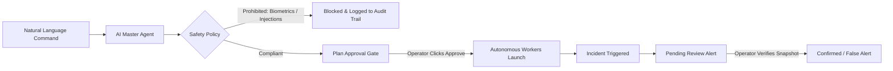

# OmniSense AI — Safety, Privacy & Ethical Architecture Specification

## 1. Executive Summary & Privacy Declaration
**OmniSense AI** is architected to perform spatial, crowd occupancy, and environmental safety monitoring **without compromising human privacy or civil liberties**. The system strictly prohibits and prevents:
- Facial recognition
- Biometric template generation or indexing
- Identity classification or individual tracking
- Persistent facial or body biometric feature storage

---

## 2. Hard Technical Privacy Enforcement

### A. Model Class Isolation (COCO Class 0 Only)
- The computer vision subsystem uses **Ultralytics YOLOv8n** configured with a hard filter:
  ```python
  results = self.model.predict(
      source=frame,
      classes=[0],  # 0 is the COCO class index for generic "person"
      conf=conf_threshold,
      imgsz=320,
      verbose=False
  )
  ```
- No facial landmarking (e.g. MediaPipe, InsightFace, dlib), face embedding models, or age/gender classifiers are installed or reachable by the codebase.

### B. Ephemeral In-Memory Frame Processing
- Video frames captured from optical camera devices are read into volatile RAM buffers (`_latest_frame`).
- Frames are processed for bounding boxes and immediately overwritten by subsequent frames.
- Raw video feeds are never recorded to disk. Only when an operator-approved spatial breach or overcrowding event triggers is a snapshot saved as **incident evidence** into `evidence/`.

### C. Anonymous Spatial Centroids
- Spatial algorithms (overcrowding and restricted-area intrusion) operate exclusively on geometric coordinates:
  - Bottom-center ground contact points: `((x1 + x2) / 2, y2)`
  - Bounding box centroids: `((x1 + x2) / 2, (y1 + y2) / 2)`
- No unique visual descriptors or Re-ID (re-identification) vectors are computed or retained across frames.

---

## 3. Human-in-the-Loop Governance Gates

OmniSense AI enforces **two strict human gates** to prevent autonomous algorithmic overreach:



### Gate 1: Plan Approval Gate
- When an operator enters a natural language command (or selects a pre-configured monitoring profile), the Master Agent generates a structured `MonitoringPlan`.
- The plan enters the database with status `pending_approval`.
- **No background vision or IoT workers can start** until an authorized human operator inspects the proposed modules, sources, and thresholds, and explicitly clicks **Approve**.

### Gate 2: Human-in-the-Loop Incident Verification Gate
- Automated algorithms are prone to environmental artifacts (shadows, reflections, sensor drift).
- Consequently, **no AI detection is ever confirmed automatically**.
- All alerts enter the database with status `pending_review` and are prominently displayed on the SOC dashboard as **"AI-detected, needs human review"**.
- Only an authorized operator can mark an event as `confirmed`, `false_positive`, or `resolved` after visually inspecting the snapshot evidence and telemetry metrics.

---

## 4. Master Agent Safety Policy & Prompt Injection Guardrails

The `SafetyPolicy` module (`backend/agents/safety.py`) evaluates incoming prompts against regex boundaries and intent classifiers before parsing:

### Blocked Threat Categories:
1. **Facial Recognition & Biometrics**:
   - Matches: `\bface\b`, `\bfaces\b`, `\bidentify\b`, `\bidentity\b`, `\bbiometric\b`, `\bchehra\b`, `\bpehchan\b`.
   - Action: **100% blocked**. Stored in `audit_logs` table with `decision: "blocked"` and `risk_level: "prohibited_violation"`.
2. **Prompt Injection & System Escapes**:
   - Matches: `ignore previous instructions`, `system prompt leak`, `rm -rf`, `powershell`, `drop table`.
   - Action: **100% blocked**. Stored in `audit_logs` with security notes.
3. **Physical Threat & Weapon Style Commands**:
   - Matches: `gun`, `weapon`, `knife`, `assault`.
   - Action: Flagged as `requires_human_review`.

---

## 5. Immutable Security Audit Ledger

Every operator command, parsed plan, and safety decision is logged permanently to the `audit_logs` table:
- **Timestamp** (UTC)
- **Operator Username & User ID**
- **Original User Command**
- **Safety Decision** (`approved_for_review`, `blocked`, `requires_human_review`)
- **Safety Notes & Explanation**

Audit records are viewable exclusively by administrators at `/audit` on the dashboard.
